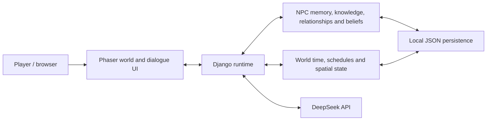

# Persistent LLM-Based NPC World

This repository contains the source code for a dissertation prototype of a persistent LLM-based NPC system for an interactive game environment.

The demo supports persistent NPC memory, task-related knowledge, player–NPC relationships, NPC-specific beliefs, world grounding, daily planning, world-time progression, and real-time player interaction.

The final demo runs through a Django web interface and can use the DeepSeek API for NPC dialogue and LLM-generated daily plans.

## Portfolio overview

A UCL dissertation prototype exploring how game NPCs can carry information across conversations and simulated days. Three characters inhabit a browser-based world, combining persistent memory, task knowledge, relationship state and individual beliefs with live LLM dialogue and daily schedules.

### Core capabilities

- **Persistent interaction:** store and retrieve NPC memories across conversations.
- **Knowledge and beliefs:** maintain task-related knowledge and NPC-specific information boundaries grounded in the world.
- **Social state:** retain player–NPC relationships that inform later interactions.
- **Planning and simulation:** generate daily plans, advance world time and move NPCs between locations.
- **LLM integration:** use DeepSeek for dialogue and planning, with deterministic planner fallback when a planning request fails.
- **Inspectable demo:** view NPC context and reset the simulation through the web interface.

### Technical architecture

| Layer | Implementation | Responsibility |
| --- | --- | --- |
| Browser interface | Django templates, JavaScript, Phaser | Tile-map world, player interaction and NPC controls |
| Web application | Python, Django | Routes, live dialogue and simulation orchestration |
| NPC state | `translator/npc_memory.py`, `world_state.py`, spatial adapters | Persistent memory, world clock and spatial state |
| Model integration | `reverie/backend_server/llm_client.py` and runtime integration | External model requests and generated responses |
| Persistence | JSON seed/runtime files; Django SQLite database | NPC/world state and local Django storage |
| Demo resources | `compressed_storage/`, static assets, simulation bootstrap files | Initial characters, movement and world map |



### Try the main interaction loop

1. Start the server using the instructions below and open the demo URL.
2. Approach an NPC and begin a conversation.
3. Make a request or create a memorable social interaction.
4. Continue the conversation and inspect the NPC context.
5. Advance world time; optionally choose `LLM → Set → Regenerate Daily Plan`.
6. Inspect subsequent dialogue, schedules and movement. Use `Clean Simulation` to reset.

### Scope and attribution

This repository publishes the curated final `live_submission_source` delivery. Working drafts, dissertation documents, evaluation logs, local databases and credentials are excluded. Required map assets and initial simulation data are retained.

The project builds on the Generative Agents / Smallville codebase by Joon Sung Park and collaborators. The dissertation work focuses on integrating persistent NPC memory, knowledge, relationships, beliefs, live interaction and daily planning into the final demo. Upstream copyright and the Apache 2.0 license are retained in `LICENSE`; bundled assets retain their accompanying notices. The bundled Cute RPG World assets are credited to PixyMoon; see their included `Read Me.txt` for asset-specific terms.

This is a local research demo. Its existing Django development settings and dependency versions are preserved; this README does not describe a production deployment.

---

## 1. Requirements

Tested environment:

- Python 3.9
- Windows 10 / 11
- Internet connection
- A valid DeepSeek API key

The project may also run on macOS or Linux, but the final submission was tested on Windows with Python 3.9.

---

## 2. Create a Virtual Environment

Open PowerShell in the project root directory.

```powershell
python -m venv .venv
.\.venv\Scripts\Activate.ps1
```

On macOS / Linux:

```bash
python3 -m venv .venv
source .venv/bin/activate
```

---

## 3. Install Dependencies

From the project root:

```powershell
pip install -r requirements.txt
```

The submitted `requirements.txt` contains the dependencies required by the final demo.

---

## 4. Configure the DeepSeek API Key

The API key must be provided through an environment variable.

Windows PowerShell:

```powershell
$env:DEEPSEEK_API_KEY="your_api_key_here"
```

macOS / Linux:

```bash
export DEEPSEEK_API_KEY="your_api_key_here"
```

Do not place the API key directly in the source code. `.env.example` documents configuration names only; the application does not automatically load a `.env` file. Set environment variables explicitly as shown above.

The environment variable must be set in the same terminal that is later used to start Django.

---

## 5. Optional Proxy Configuration

This step is only required if the local network needs an HTTP proxy to access the DeepSeek API.

Windows PowerShell example:

```powershell
$env:HTTP_PROXY="http://your-proxy-host:port"
$env:HTTPS_PROXY="http://your-proxy-host:port"
```

If no proxy is required, skip this step.

The proxy variables must be set in the same terminal used to start the Django server.

---

## 6. Initialize Django

Move into the Django server directory:

```powershell
cd environment\frontend_server
```

Run database migrations:

```powershell
python manage.py migrate
```

Migration messages may be shown on the first run. This is expected.

---

## 7. Start the Demo Server

From `environment\frontend_server`, run:

```powershell
python manage.py runserver
```

A successful startup should show a message similar to:

```text
System check identified no issues (0 silenced).
Starting development server at http://127.0.0.1:8000/
```

---

## 8. Open the Demo

Open:

```text
http://127.0.0.1:8000/demo/simplified_pipeline_demo/60/3/
```

The submitted demo starts from a clean persistent-world state at approximately:

```text
Day 1 / 07:00
```

---

## 9. Basic Controls

The player can move around the map using the keyboard controls available in the interface.

The demo also provides controls for advancing world time. As world time advances:

- NPC schedules are executed
- NPC actions change
- NPC spatial positions can change
- observations and task results can be stored
- persistent context can influence later interaction and planning

---

## 10. Using the LLM Daily Planner


To generate daily plans using DeepSeek:

1. Select `LLM` in the Planner control
2. Click `Set`
3. Click `Regenerate Daily Plan`

When successful, the NPC panel should show:

```text
Daily Plan Source: llm
```

If the DeepSeek request fails, the system automatically uses the deterministic fallback planner:

```text
Daily Plan Source: deterministic_fallback
```

This fallback is part of the runtime design and prevents a failed external API request from stopping the simulation.

---

## 11. Interacting with NPCs

Approach an NPC in the game world and use the dialogue interface.

The live NPC dialogue system can use persistent context including:

- Memory
- Knowledge
- Active goals
- Player–NPC relationship state
- NPC beliefs
- World grounding
- Recent dialogue and world state

Player interactions can write new persistent information that may later affect NPC responses and planning.

---

## 12. Main System Features

### Persistent Memory

NPC interactions can be stored as persistent memories and retrieved in later conversations.

### Knowledge

NPCs can create task-related knowledge from completed actions, observations, and interpreted evidence.

### Relationship System

Player interactions can affect persistent relationship state and relationship memories.

### Belief and Grounding

NPC responses are constrained by world facts and by the information available to the individual NPC, reducing omniscient chatbot behaviour.

### Daily Planning

NPC daily schedules can be generated by either deterministic planning or DeepSeek-based LLM planning.

The LLM planner uses persistent NPC context when generating schedules.

### Persistent World Time

The world clock can advance through the day and across multiple days. NPC actions and planning are tied to world time.

### Spatial Behaviour

Scheduled actions can result in NPC movement between locations in the game world.

---

## 13. Resetting the Demo

The interface includes a `Clean Simulation` control.

It resets the main runtime state, including:

- interaction memories
- NPC goals
- NPC knowledge
- NPC relationships
- active and completed runtime actions
- previous-day runtime state
- generated daily plans
- world time

The demo returns to a clean Day 1 state.

For the cleanest reset, select deterministic planner mode before running `Clean Simulation`.

---

## 14. Troubleshooting

### DeepSeek API requests fail

Confirm that the API key is available in the same PowerShell session:

```powershell
python -c "import os; print(bool(os.environ.get('DEEPSEEK_API_KEY')))"
```

Expected output:

```text
True
```

If the machine requires a proxy, check:

```powershell
python -c "import urllib.request; print(urllib.request.getproxies())"
```

Incorrect or stale proxy settings can prevent the Django process from reaching the API.

### The browser still opens the demo after the server was stopped

A previous Django process may still be listening on port 8000.

Check:

```powershell
netstat -ano | findstr :8000
```

If an old process is still listening, terminate it using its PID:

```powershell
taskkill /PID <PID> /F
```

Then restart Django from the intended terminal.

### LLM planner falls back

The LLM planner includes automatic fallback handling.

Possible causes include:

- unavailable API key
- network or proxy problems
- API latency
- invalid or incomplete model output

The deterministic fallback keeps the simulation usable even when the external LLM request fails.

---

## 15. Project Structure

Important directories:

```text
environment/
    frontend_server/
        Django frontend and runtime integration

experiments/
    configs/
        Agent configuration files
    player_intervention/
        Persistent runtime state, memory, relationship, knowledge and debug data

reverie/
    backend_server/
        Supporting simulation resources and bootstrap data
```

The final demo depends on the included bootstrap simulation resources. Do not remove the submitted simulation data files from the repository.

---

## 16. Notes on External Services

The final web demo uses the DeepSeek API for:

- live NPC dialogue
- LLM daily planning
- selected LLM-based interpretation tasks

The system also contains deterministic fallbacks for runtime robustness.

API availability, latency, and model behaviour are external to the submitted source code and may vary over time.

---

## 17. Quick Start

Windows PowerShell:

```powershell
python -m venv .venv
.\.venv\Scripts\Activate.ps1

pip install -r requirements.txt

$env:DEEPSEEK_API_KEY="your_api_key_here"

cd environment\frontend_server

python manage.py migrate
python manage.py runserver
```

Then open:

```text
http://127.0.0.1:8000/demo/simplified_pipeline_demo/60/3/
```

To test LLM planning:

```text
Planner -> LLM -> Set -> Regenerate Daily Plan
```

To test persistent behaviour:

1. interact with an NPC
2. create a memorable request or social interaction
3. continue the conversation
4. advance world time
5. regenerate a daily plan
6. observe how persistent context influences later behaviour

---

## License

See `LICENSE` for license and attribution information.
